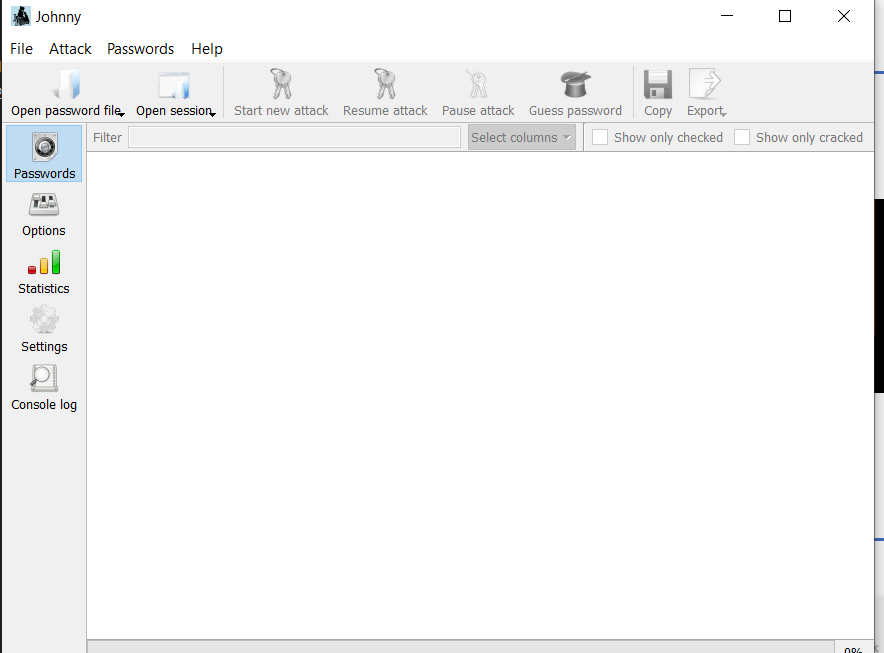
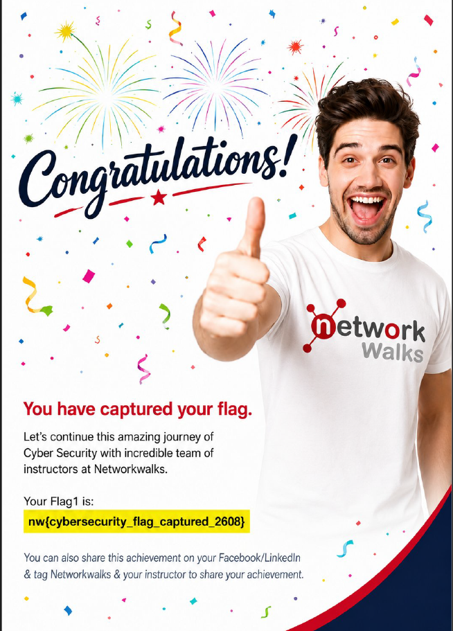
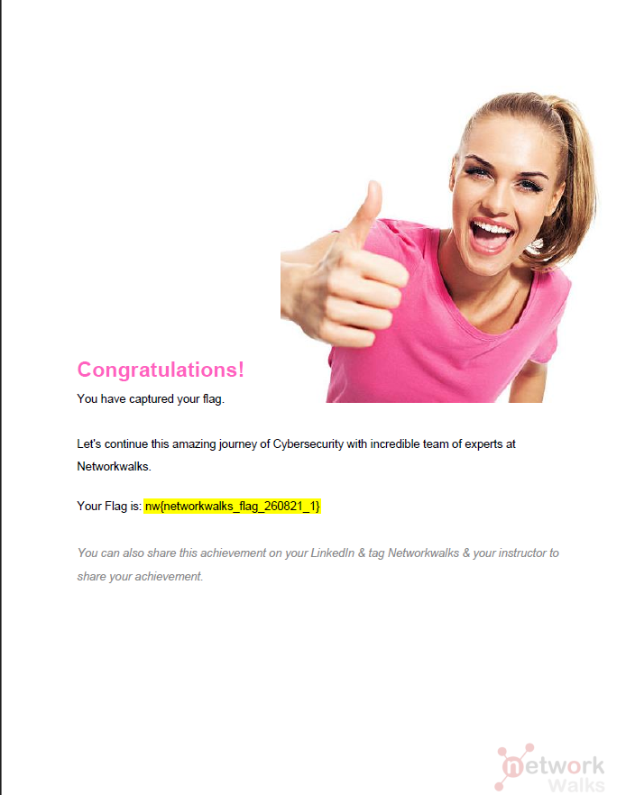
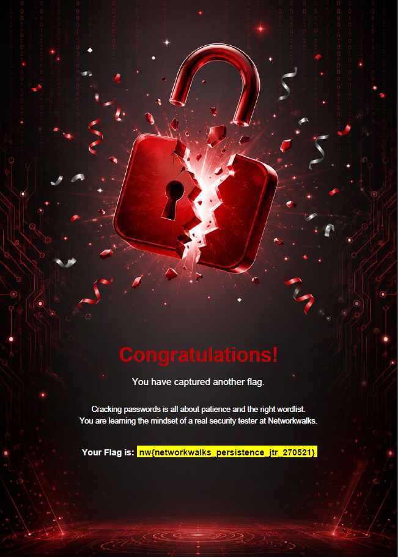
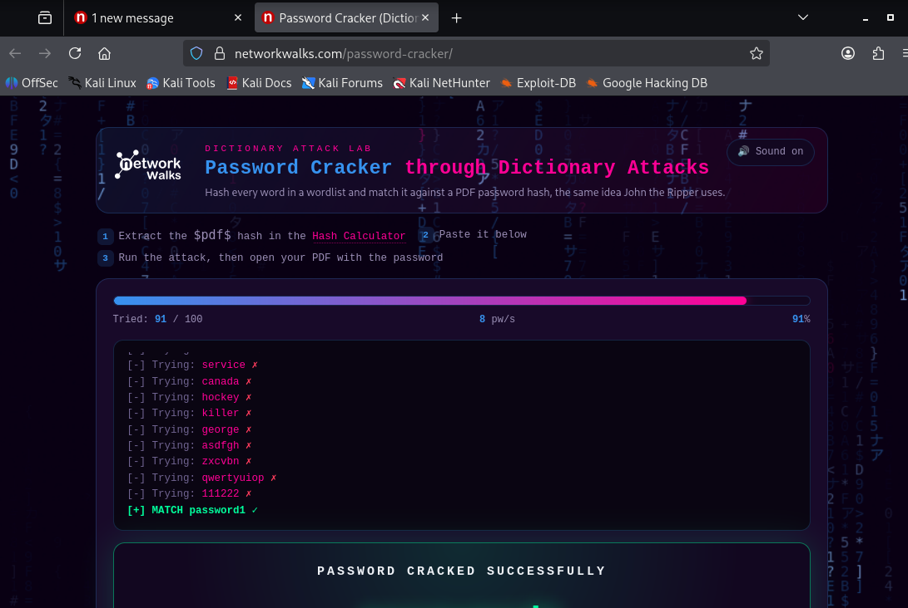

# NETWORKWALKS-CARLYNDA-AMOAH-B084-WK3-PM1-PM2-PASSWORD-HASHING-CRACKING

## Overview

This repository documents my Week 3 work for the Cybersecurity at Networkwalks internship program (batch B084N). This week's focus was **password hashes and password cracking using John the Ripper (JTR)**.

The work is split into two project modules:

- **PM1** – Cracking a password-protected PDF using Johnny (the JTR GUI frontend) and John the Ripper
- **PM2** – Understanding and performing password cracking through a dictionary attack

---

## PM1: Cracking a PDF Password with Johnny / John the Ripper

### Objective

To extract the hash of a password-protected PDF and recover its password using John the Ripper, in order to understand how security professionals test password strength.

### Tools Used

- **John the Ripper (John)** – password cracking tool
- **Johnny** – GUI frontend for John the Ripper
- **onlinehashcrack.com** – used to extract the hash value from the locked PDF

### Steps

1. Downloaded and set up John the Ripper and Johnny.

   

2. Used onlinehashcrack.com to extract the hash value from the password-protected PDF provided by Networkwalks. The hash began with `$pdf$...`.
3. Copied the hash value and pasted it into Notepad, then saved it as a `.txt` file.
4. Opened Johnny and clicked **Open password file**, selecting the saved `.txt` hash file.
5. Clicked **Start new attack** and let Johnny run John the Ripper against the hash.
6. Successfully recovered the password for the locked PDF.

   

   

### What I Learned

- **Encryption is two-way**: plaintext is encrypted with a key to protect it, and the encrypted data can later be decrypted using that same key to recover the original information.
- **Hashing is one-way**: plaintext is passed through a hash function to produce a fixed hash value that cannot be reversed back into the original text. Hashing is used to validate/verify information rather than retrieve it.
- Johnny makes it easier to visualize and manage password-cracking attacks without needing to memorize John the Ripper's command-line syntax.

### Flags Captured

✅ `nw{cybersecurity_flag_captured_2608}`
✅ `nw{networkwalks_persistence_jtr_270521}`

---

## PM2: Password Cracking via Dictionary Attack

### Objective

To understand how passwords are recovered from stored/protected data, and to test how strong a password is using a dictionary attack.

### What is Password Cracking?

Password cracking is the process of recovering passwords from stored data or protected files. It is commonly used to test how strong or weak a password is.

### How It Works

1. A password is typically stored as a **hash** — a string of scrambled values generated from the original password.
2. To crack the password, the hash is first extracted (using a hash calculator/extractor).
3. The extracted hash is then run through a cracking tool.

   

4. The tool performs a **dictionary attack**, testing different words from a wordlist against the hash until it finds a match.
5. Once a match is found, the original password is revealed.

   

### What I Learned

- Hashing is used to securely store passwords rather than saving them as plain text.
- A dictionary attack relies on a wordlist of common passwords/phrases, trying each one until a match is found.
- Password strength matters: weak or common passwords are cracked much faster than complex, unique ones.
- Cracking passwords requires patience — the right wordlist is just as important as the tool itself.

### Flag Captured

✅ `nw{networkwalks_flag_260821_1}`

---

## Evidence / Screenshots

All supporting screenshots are in the `screenshots/` folder:

| File | Description |
|---|---|
| `PM1_Johnny.PNG` | Johnny (JTR frontend) interface |
| `PM1_locked1.PNG` | Flag captured for locked PDF 1 |
| `PM1_locked3.PNG` | Flag captured for locked PDF 3 |
| `PM2_locked2.PNG` | Dictionary attack running against locked PDF 2's hash |
| `PM2_locked2_cracked_pwd.PNG` | Password cracked successfully for locked PDF 2 |

---

## Key Takeaways for the Week

- Encryption (two-way, reversible with a key) vs. Hashing (one-way, used for validation) are fundamentally different concepts.
- Password cracking tools like John the Ripper/Johnny test password strength by attempting to match hashes against known wordlists.
- Good password hygiene (length, complexity, uniqueness) is the best defense against dictionary attacks.

---

---

# 👤 Author

**Carlynda Amoah**\
Cybersecurity Professional B084N

LinkedIn: [https://www.linkedin.com/in/carlynda-amoah-530779292/](https://www.linkedin.com/in/carlynda-amoah-530779292/)

---

## 📌 Project Information

**Program Name:** Cybersecurity program at Networkwalks | **Week:** 03 | **Repository:** GitHub

*Part of the Cybersecurity at Networkwalks internship program — Batch B084N*
